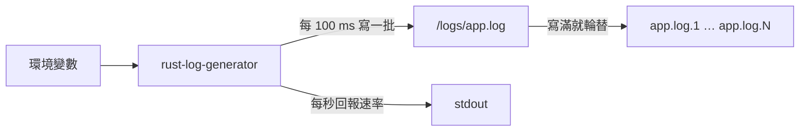

# rust-log-generator

rust-log-generator 是用 Rust 寫的 log 產生器，會依照你設定的速率（每秒幾 MiB）持續把 log 寫進檔案，格式可以選 JSON 或純文字。

適合拿來測試需要穩定 log 流量的東西，例如 log 收集管線的吞吐量，或儲存空間的寫入表現。

## Key Features

- **速率可調**：用 `LOG_RATE_MIB` 設定每秒寫入幾 MiB，可以用小數（例如 `0.5`）。設定 5 時實測為 5.00 MiB/s。
- **JSON 或純文字**：用 `LOG_JSON` 切換，兩種格式的欄位相同。
- **每行固定 256 bytes**：流量可以直接換算成行數，1 MiB 就是 4,096 行。
- **依大小輪替**：檔案寫滿就換新檔，只保留最近幾個檔案，所以占用的磁碟空間有上限。
- **磁碟用量上限**：輪替設定加起來超過 `LOG_MAX_TOTAL_MIB` 時，程式會拒絕啟動。
- **卡住後不爆量**：磁碟變慢或 process 被暫停時，落後超過 1 秒的量會直接放棄，不會事後一口氣補寫。
- **映像檔很小**：靜態連結的單一執行檔放在 `scratch`（空白）映像檔裡，以非 root 的 UID 65532 執行。
- **符合 Pod Security Standards `restricted`**：Kubernetes 內建的最嚴格 Pod 安全等級，`k8s/overlay/prod` 直接套用。

### 設定

所有設定都用環境變數，沒設定的就用預設值。設定值不合法時，程式會在 stderr 印出原因並結束（exit code 1）。

| 環境變數 | 預設值 | 說明 |
|---|---|---|
| `LOG_RATE_MIB` | `1` | 每秒寫入幾 MiB，必須大於 0，可以用小數 |
| `LOG_JSON` | `true` | `true` 輸出 JSON，`false` 輸出純文字，不分大小寫 |
| `LOG_DIR` | `/logs` | log 檔所在的目錄，不存在時會自動建立 |
| `LOG_MAX_FILE_MIB` | `100` | 單一檔案的大小上限（MiB），正整數 |
| `LOG_MAX_FILES` | `5` | 最多保留幾個檔案，包含正在寫入的那一個，正整數 |
| `LOG_MAX_TOTAL_MIB` | `1024` | `LOG_MAX_FILE_MIB` × `LOG_MAX_FILES` 的上限（MiB），正整數 |

## Quick Start

### 部署到 Kubernetes

先準備好：

- 執行指令的電腦上要有 `kubectl` 和 `git`。`kubectl` 會用 `git` 把這個 repo 抓下來。
- 叢集要有預設的 StorageClass（動態配置儲存空間的設定）。用 `kubectl get storageclass` 查，名稱後面有 `(default)` 的就是。
- 節點要能連到 `registry.gitlab.com` 下載映像檔。映像檔是公開的，不需要帳號密碼。

已在 Kubernetes v1.37 測試過。

一行指令部署：

```bash
kubectl apply -k 'https://gitlab.com/kubeantony/rust-log-generator.git//k8s/overlay/prod?ref=main'
```

這會建立 `rust-log-generator` 這個 namespace，以及裡面存放設定值的 ConfigMap、1 GiB 的 PersistentVolumeClaim（PVC，向叢集申請的一塊儲存空間）和 Deployment。Pod 啟動後以 1 MiB/s 寫入 JSON log，檔案最多占 500 MiB。

確認已經在執行：

```bash
kubectl -n rust-log-generator rollout status deployment/rust-log-generator
kubectl -n rust-log-generator logs deployment/rust-log-generator --tail=5
```

程式啟動時會在 stdout 印出目前的設定，之後每秒回報一次實際的寫入速率。把 `--tail=5` 拿掉就能看到開頭：

```text
rust-log-generator: run 604f8f26: writing 1 MiB/s of JSON logs to /logs/app.log (rotate at 100 MiB, keep 5 files)
rust-log-generator: 1.00 MiB/s (total 1.0 MiB)
rust-log-generator: 1.00 MiB/s (total 2.1 MiB)
```

產生的 log 寫在 PVC 裡的 `/logs/app.log`，不是 stdout。映像檔裡沒有 shell，所以不能用 `kubectl exec` 進去看檔案。

要調整速率或格式：把這個 repo clone 下來，修改 `k8s/base/kustomization.yaml` 裡的設定值，再執行 `kubectl apply -k k8s/overlay/prod`。

移除：

```bash
kubectl delete -k 'https://gitlab.com/kubeantony/rust-log-generator.git//k8s/overlay/prod?ref=main'
```

這會連同 namespace 和 PVC 一起刪除。大多數 StorageClass 會在 PVC 刪除時清掉資料，所以寫好的 log 檔也會消失。

### 用 podman 在本機執行

不需要 Kubernetes 也能執行。下面的指令以 5 MiB/s 寫入純文字 log，檔案存在名為 `logs` 的 volume 裡，按 Ctrl+C 停止：

```bash
podman run --rm -e LOG_RATE_MIB=5 -e LOG_JSON=false -v logs:/logs \
  registry.gitlab.com/kubeantony/rust-log-generator:0.1.1
```

## How It Works



程式只有一個執行緒，啟動後重複做下面幾件事，直到收到 SIGTERM 或 SIGINT（Kubernetes 停止 Pod 或按下 Ctrl+C 時送出的訊號）。

**控制速率。** 程式每 100 ms 醒來一次，算出「從啟動到現在總共應該寫多少 bytes」，再補寫到這個數字為止。因為比對的是累計值而不是每一輪的量，某一輪寫多或寫少都會在下一輪修正，長時間的平均速率不會偏移。如果落後超過 1 秒的量（例如磁碟卡住），超出的部分會直接放棄。

**產生 log。** 每一行固定 256 bytes（含換行），不夠的長度用重複的填充文字補滿。JSON 格式：

```json
{"ts":"2026-11-05T12:21:20.693Z","level":"INFO","run":"5d8280fd","seq":0,"msg":"the quick brown fox jumps over the lazy dog the quick …"}
```

純文字格式：

```text
2026-11-05T12:21:36.415Z INFO run=eb17a6fb seq=0 the quick brown fox jumps over the lazy dog the quick …
```

| 欄位 | 內容 |
|---|---|
| `ts` | UTC 時間，精確到毫秒 |
| `level` | 每 10 行有 7 行 `INFO`，`DEBUG`、`WARN`、`ERROR` 各 1 行 |
| `run` | 每次啟動隨機產生的 8 位十六進位代號 |
| `seq` | 行號，每次啟動從 0 開始，每行加 1 |

程式重新啟動後 `seq` 會從 0 重新算，所以要用 `run` 加 `seq` 才能唯一識別一行。接收 log 的那一端可以檢查 `seq` 有沒有連續，判斷中間有沒有掉行。

**輪替檔案。** 下一行會讓 `app.log` 超過 `LOG_MAX_FILE_MIB` 時，`app.log` 改名為 `app.log.1`，原本的 `app.log.1` 變成 `app.log.2`，依此類推，最舊的那個檔案被刪除。連同 `app.log` 在內最多保留 `LOG_MAX_FILES` 個檔案。以預設值來說，就是 5 個檔案、每個 100 MiB，最多占 500 MiB。

**結束。** 收到 SIGTERM 或 SIGINT 後，程式把還在記憶體裡的資料寫進檔案，然後正常結束（exit code 0）。

### Kubernetes 設定

設定檔用 Kustomize（`kubectl` 內建的設定檔組合工具）分成兩層：

| 目錄 | 內容 |
|---|---|
| `k8s/base` | Deployment、PVC，以及存放設定值的 ConfigMap |
| `k8s/overlay/prod` | 在 base 之上加入 namespace 和 `restricted` 等級要求的安全設定 |

`k8s/overlay/prod` 加上的安全設定：

- namespace 啟用 Pod Security Standards `restricted`，不符合的 Pod 會被拒絕。
- container 以非 root 身分執行（UID 65532）、不能提升權限、移除所有 Linux capabilities（從 root 權限拆出來的各項特權）、啟用預設的 seccomp 設定（限制 process 能用的系統呼叫）。
- 根檔案系統唯讀，只有 `/logs` 可以寫入。

另外有兩點要注意：

- 映像檔用 digest（內容的雜湊值）指定，不是用 tag，所以部署的一定是同一份映像檔。
- Deployment 把 `LOG_MAX_TOTAL_MIB` 設為 900，略小於 1 GiB 的 PVC，因為不是每種儲存空間都會強制執行 PVC 的容量限制。

## License

以 [Apache License 2.0](LICENSE) 授權。
