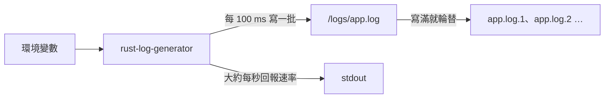

# rust-log-generator

rust-log-generator 是用 Rust 寫的 log 產生器，會依照你設定的速率（每秒幾 MiB，1 MiB 是 1024 × 1024 bytes）持續把 log 寫進檔案，格式可以選 JSON 或純文字。

適合用來測試需要穩定 log 流量的情境，例如 log 收集管線的處理量，或儲存空間的寫入效能。

這個專案是和 Claude Code 一問一答開發出來的，開發過程記錄在 [user-questions.md](user-questions.md)。

## Key Features

- **自訂寫入速率**：設定每秒要寫幾 MiB，程式就穩定照這個速率輸出。
- **JSON 或純文字**：改一個設定就能切換 log 格式。
- **磁碟用量有上限**：log 檔寫滿就輪替，只保留最近幾個檔案。
- **檢查得出掉行**：每一行都有編號，接收端可以確認 log 有沒有漏掉。
- **一行指令部署到 Kubernetes**：附上現成的設定檔，符合 Kubernetes 內建最嚴格的安全等級。

### 設定

所有設定都用環境變數，沒設定的就用預設值。設定值不合法時，程式會印出原因並結束（exit code 1）。訊息印在 stderr（程式輸出錯誤訊息的管道），在 Kubernetes 上用 `kubectl logs` 就看得到。

| 環境變數 | 預設值 | 說明 |
|---|---|---|
| `LOG_RATE_MIB` | `1` | 每秒寫入幾 MiB，可以用小數。最小是每秒 1 byte（約 `0.00000096`），再小就寫不出完整的一行 |
| `LOG_JSON` | `true` | `true` 輸出 JSON，`false` 輸出純文字，不分大小寫 |
| `LOG_DIR` | `/logs` | log 檔所在的目錄，不存在時會自動建立 |
| `LOG_MAX_FILE_MIB` | `100` | 單一檔案的大小上限（MiB），正整數 |
| `LOG_MAX_FILES` | `5` | 最多保留幾個檔案，包含正在寫入的那一個，正整數 |
| `LOG_MAX_TOTAL_MIB` | `1024` | `LOG_MAX_FILE_MIB` × `LOG_MAX_FILES` 的上限（MiB），正整數。超過時程式會拒絕啟動 |

## Quick Start

### 部署到 Kubernetes

先準備好：

- 執行指令的電腦上要有 `kubectl` 和 `git`。`kubectl` 會用 `git` 把這個 repo 抓下來。
- `kubectl` 已經連上叢集，而且有權限建立 namespace（叢集裡用來分隔資源的空間）。執行 `kubectl get nodes` 列得出節點（叢集裡的機器），就表示已經連上。
- 叢集要有預設的 StorageClass（動態配置儲存空間的設定）。用 `kubectl get storageclass` 查，名稱後面有 `(default)` 的就是。
- 節點要能連到 `registry.gitlab.com` 下載映像檔。映像檔是公開的，不需要帳號密碼。

已在 Kubernetes v1.37 測試過。

一行指令部署：

```bash
kubectl apply -k 'https://gitlab.com/kubeantony/rust-log-generator.git//k8s/overlay/prod?ref=main'
```

這會建立 `rust-log-generator` 這個 namespace，以及裡面存放設定值的 ConfigMap、1 GiB 的 PersistentVolumeClaim（PVC，向叢集申請的一塊儲存空間）、Deployment（負責建立 Pod 並讓它持續執行），以及禁止所有網路連線的 NetworkPolicy。Pod（Kubernetes 執行 container 的最小單位）啟動後以 1 MiB/s 寫入 JSON log，檔案最多占 500 MiB。

確認已經在執行：

```bash
kubectl -n rust-log-generator rollout status deployment/rust-log-generator
kubectl -n rust-log-generator logs deployment/rust-log-generator --tail=5
```

程式啟動時會在 stdout（程式輸出一般訊息的管道）印出目前的設定，之後大約每秒回報一次實際的寫入速率。要看開頭的設定，改用：

```bash
kubectl -n rust-log-generator logs deployment/rust-log-generator | head -n 3
```

```text
rust-log-generator: run 604f8f26: writing 1 MiB/s of JSON logs to /logs/app.log (rotate at 100 MiB, keep 5 files)
rust-log-generator: 1.00 MiB/s (total 1.0 MiB)
rust-log-generator: 1.00 MiB/s (total 2.1 MiB)
```

產生的 log 寫在 PVC 裡的 `/logs/app.log`，不是 stdout。映像檔裡只有程式本身，沒有 shell 也沒有 `cat` 這類工具，所以不能用 `kubectl exec` 進去看檔案。要看檔案內容，可以用 `kubectl debug` 在 Pod 裡臨時加一個帶有工具的 container：

```bash
POD=$(kubectl -n rust-log-generator get pod -l app.kubernetes.io/name=rust-log-generator -o name)
kubectl -n rust-log-generator debug "$POD" -i --image=docker.io/library/busybox:1.37 \
  --target=rust-log-generator --profile=restricted -- tail -n 2 /proc/1/root/logs/app.log
```

這會先印出幾行 `kubectl` 的提示，接著是 `app.log` 的最後兩行。`/proc/1/root` 是從臨時 container 看到的程式檔案系統。節點要能從 `docker.io` 下載 `busybox` 映像檔。每執行一次，Pod 裡就會留下一個已結束的臨時 container，Pod 重建後才會消失。

要調整速率或格式，先把這個 repo 抓下來：

```bash
git clone https://gitlab.com/kubeantony/rust-log-generator.git
cd rust-log-generator
```

修改 `k8s/base/kustomization.yaml` 裡的設定值，再部署：

```bash
kubectl apply -k k8s/overlay/prod
```

`LOG_MAX_FILE_MIB` × `LOG_MAX_FILES` 不能超過 900，原因見下方「Kubernetes 設定」一節。

移除：

```bash
kubectl delete -k 'https://gitlab.com/kubeantony/rust-log-generator.git//k8s/overlay/prod?ref=main'
```

這會連同 namespace 和 PVC 一起刪除。大多數 StorageClass 會在 PVC 刪除時清掉資料，所以寫好的 log 檔也會消失。

### 用 podman 在本機執行

不需要 Kubernetes 也能執行。下面的指令以 5 MiB/s 寫入純文字 log，檔案存在名為 `rust-log-generator-logs` 的 volume（podman 管理的儲存空間）裡。這個 volume 不存在時，podman 會自動建立。按 Ctrl+C 停止：

```bash
podman run --rm -e LOG_RATE_MIB=5 -e LOG_JSON=false -v rust-log-generator-logs:/logs \
  registry.gitlab.com/kubeantony/rust-log-generator:0.1.1
```

停止後 log 檔還留在 volume 裡，不需要時用 `podman volume rm rust-log-generator-logs` 刪除。

## How It Works



程式只有一個執行緒，啟動後不斷重複控制速率、產生 log、輪替檔案這三件事，直到收到 SIGTERM 或 SIGINT（Kubernetes 停止 Pod 或按下 Ctrl+C 時送出的訊號）才結束。

**控制速率。** 程式每 100 ms 醒來一次，算出「從啟動到現在總共應該寫多少 bytes」，再補寫到這個數字為止。因為比對的是累計值而不是每一輪的量，某一輪寫多或寫少都會在下一輪修正，長時間的平均速率不會偏移。如果落後太多（例如磁碟卡住），最多只補 1 秒份的量，超出的部分直接放棄，不會事後一口氣補寫。

**產生 log。** 每一行固定 256 bytes（含換行），所以 1 MiB 剛好是 4,096 行。不夠的長度用重複的填充文字補滿，下面的範例省略了後段的填充文字。JSON 格式：

```json
{"ts":"2026-11-05T12:21:20.693Z","level":"INFO","run":"5d8280fd","seq":0,"msg":"the quick brown fox jumps over the lazy dog the quick …"}
```

純文字格式：

```text
2026-11-05T12:21:36.415Z INFO run=eb17a6fb seq=0 the quick brown fox jumps over the lazy dog the quick …
```

| 欄位 | 內容 |
|---|---|
| `ts` | UTC 時間，精確到毫秒 |
| `level` | 每 10 行有 7 行 `INFO`，`DEBUG`、`WARN`、`ERROR` 各 1 行 |
| `run` | 每次啟動隨機產生的 8 位十六進位代號 |
| `seq` | 行號，每次啟動從 0 開始，每行加 1 |
| `msg` | 填充文字，用來把每一行補到 256 bytes |

純文字格式的欄位順序相同，只有 `run` 和 `seq` 帶有欄位名稱。

程式重新啟動後 `seq` 會從 0 重新算，所以要用 `run` 加 `seq` 才能唯一識別一行。接收 log 的那一端可以檢查 `seq` 有沒有連續，判斷中間有沒有掉行。

**輪替檔案。** 下一行會讓 `app.log` 超過 `LOG_MAX_FILE_MIB` 時，`app.log` 改名為 `app.log.1`，原本的 `app.log.1` 變成 `app.log.2`，依此類推，最舊的那個檔案被刪除。連同 `app.log` 在內最多保留 `LOG_MAX_FILES` 個檔案，所以編號最大是 `LOG_MAX_FILES` − 1。以預設值來說，就是 `app.log` 到 `app.log.4` 這 5 個檔案、每個 100 MiB，最多占 500 MiB。

執行中如果 `app.log` 被刪除，或被換成另一個檔案，程式會在下一輪（100 ms 內）發現，改寫到路徑上現有的 `app.log`；檔案或目錄不存在就重新建立。如果路徑上的東西打不開（例如沒有寫入權限），程式會繼續寫原本的檔案，等下一次輪替再換新檔。

**結束。** 收到 SIGTERM 或 SIGINT 後，程式把還在記憶體裡的資料寫進檔案，然後正常結束（exit code 0）。

### Kubernetes 設定

設定檔用 Kustomize（`kubectl` 內建的設定檔組合工具）分成兩層：

| 目錄 | 內容 |
|---|---|
| `k8s/base` | Deployment、PVC，以及存放設定值的 ConfigMap |
| `k8s/overlay/prod` | 在 base 之上加入 namespace、Pod Security Standards `restricted`（Kubernetes 內建最嚴格的 Pod 安全等級）要求的安全設定、唯讀的根檔案系統，以及禁止所有網路連線的 NetworkPolicy |

`k8s/overlay/prod` 加上的安全設定：

- namespace 啟用 Pod Security Standards `restricted`，不符合的 Pod 會被拒絕。
- container 以非 root 身分執行（UID 65532）、不能提升權限、移除所有 Linux capabilities（從 root 權限拆出來的各項特權）、啟用預設的 seccomp 設定（限制 process 能用的系統呼叫）。
- 根檔案系統唯讀，只有 `/logs` 可以寫入。
- NetworkPolicy 禁止 namespace 裡所有 Pod 的對內和對外連線，包含 DNS。程式只寫檔案，不需要網路。叢集的網路外掛（CNI）要支援 NetworkPolicy，這項限制才會生效。

另外有兩點要注意：

- 映像檔用 digest（內容的雜湊值）指定，不是用 tag，所以部署的一定是同一份映像檔。
- Deployment 把 `LOG_MAX_TOTAL_MIB` 設為 900，略小於 1 GiB 的 PVC。不是每種儲存空間都會強制執行 PVC 的容量限制，所以由程式自己把關。`LOG_MAX_FILE_MIB` × `LOG_MAX_FILES` 超過 900 時，Pod 會啟動失敗。要放寬的話，`k8s/base/pvc.yaml` 的容量和 `k8s/base/deployment.yaml` 裡的這個值要一起加大。

### 測試

測試分成三層：

| 測試 | 內容 | 怎麼執行 |
|---|---|---|
| 單元測試（`src/` 各檔案內） | 設定、格式、速率計算、輪替 | 建置映像檔時自動執行，沒通過就建不出映像檔 |
| 端到端測試（`tests/e2e.rs`） | 實際執行編譯出來的程式，檢查輸出、結束方式和錯誤處理 | 同上 |
| 映像檔檢查（`tests/image/e2e.py`） | 用 podman 執行映像檔，量測速率準確度，並模擬磁碟寫滿、暫停、檔案被刪除、強制終止等狀況 | 發佈映像檔之前手動執行，約 7 分鐘 |

映像檔檢查的執行方式：

```bash
podman build -t rust-log-generator:dev .
python3 tests/image/e2e.py rust-log-generator:dev
```

## License

以 [Apache License 2.0](LICENSE) 授權。
